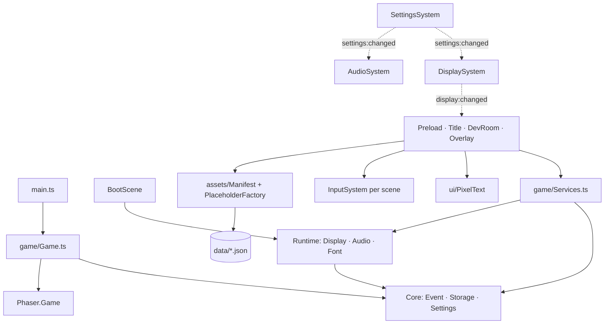

# UNCLAIMED — 기술 아키텍처

> 문서 버전 0.1 · PHASE 1 기준 · 코드와 어긋나면 코드를 기준으로 이 문서를 고칩니다.

## 1. 기술 스택 (확정)

| 영역 | 선택 | 버전 | 이유 |
|---|---|---|---|
| 언어 | TypeScript (strict, `noUncheckedIndexedAccess`) | 5.9.3 | 데이터 주도 게임에서 타입이 곧 콘텐츠 검증 |
| 엔진 | Phaser 3 | 3.90.0 | 지시된 엔진. 3.x 최종 안정판. (4.x는 API가 크게 다르고 생태계가 아직 3.x 중심) |
| 번들러 | Vite | 7.3.8 | 빠른 HMR, 정적 호스팅 가능한 상대 경로 빌드 (`base: './'`) |
| 테스트 | Vitest (단위) + Playwright (브라우저 스모크) | 4.1.12 | 순수 로직은 Node에서, 렌더링·입력·배율은 실제 Chromium에서 |
| 오디오 | Web Audio API (Phaser의 AudioContext 공유) | — | 합성 효과음·캐릭터 보이스 블립, 버스 단위 볼륨 |
| 저장 | LocalStorage + 버전 봉투(envelope) | — | 손상·구버전·미래버전 데이터를 중단 없이 처리 |
| 폰트 | Galmuri11 / Galmuri11 Bold / Galmuri9 (SIL OFL 1.1) | 2.40.3 | 한글 11,172자 전부 포함한 픽셀 폰트 |

**추가 도입을 보류한 것과 이유**

- **Howler.js** — Phaser가 이미 Web Audio 언락·디코딩을 처리합니다. 중복 레이어를 피합니다.
- **GSAP** — Phaser Tweens로 충분합니다. 컷신 타임라인이 복잡해지는 PHASE 7에서 재검토합니다.
- **Zustand** — 상태는 `GameState`(PHASE 2) + 타입 이벤트 버스로 관리합니다. React가 없으므로 이점이 작습니다.
- **Tiled** — PHASE 2에서 도입합니다(맵 JSON 포맷). 런타임 의존성은 없고 에디터만 씁니다.

## 2. 렌더링 원칙: 480×270 네이티브 픽셀

모든 아트·UI·텍스트는 **480×270 백버퍼**에 그려지고, 그 캔버스를 통째로 확대합니다.

- 1080p에서 정확히 4배, 4K에서 8배. 16px 타일 기준 화면에 30×17타일.
- `pixelArt: true`, `roundPixels: true`, CSS `image-rendering: pixelated`.
- **기기 픽셀 기준 정수 배율** (`src/utils/ScaleUtils.ts`): Windows 125% 배율의 1536×864 CSS 화면은 실제 1920×1080 기기 픽셀이므로, CSS 3배(=기기 3.75배, 픽셀 폭 불균일)가 아니라 기기 4배(=CSS 3.2배)를 선택합니다. 캔버스 위치도 기기 픽셀 격자에 맞춥니다.
- 배율 모드: `auto`(정수 배율이 최대 크기의 85% 이상이면 정수, 아니면 화면 맞춤) / `pixel-perfect` / `fit`. 설정에 저장됩니다.
- 회전·확대로 스프라이트를 변형하지 않습니다(픽셀이 뭉개짐). 흔들림은 위치 이동으로, 크기 변화는 정수 배율로만 표현합니다.
- 그라데이션은 블렌딩 대신 **Bayer 디더링**으로 팔레트 색만 사용합니다 (`src/utils/DitherUtils.ts`).

### 2.1 한글 픽셀 텍스트 파이프라인

캔버스 `fillText`는 안티에일리어싱이 들어가 480×270에서 회색 번짐이 생기고, 확대하면 얼룩이 됩니다. 한글은 완성형만 11,172자라 사전 제작 비트맵 폰트도 비현실적입니다.

`src/systems/FontSystem.ts`의 해법:
1. 웹 폰트(Galmuri)를 **네이티브 크기**(11→12px, 9→10px)에서 글자 단위로 래스터화
2. 알파 임계값 처리 → 1비트 픽셀로 변환
3. 공유 아틀라스(256px에서 시작, 필요 시 2배씩 최대 2048px)에 패킹 → Phaser BitmapFont로 등록
4. **처음 쓰이는 순간 동적으로 추가**. 대사 데이터는 로딩 중 `fonts.preload(text)`로 미리 굽습니다(PHASE 3).
5. 글자는 흰색, 색은 틴트. 큰 글씨는 폰트를 정수배(2x, 3x)로 확대.

모든 게임 내 텍스트는 `PixelText`(`src/ui/PixelText.ts`)를 씁니다. `Phaser.Text`는 사용하지 않습니다.

## 3. 계층 구조

```
┌─────────────────────────────────────────────────────────┐
│ scenes/  (Phaser Scene: 흐름과 조립만)                   │
│ ui/      (Phaser GameObject 기반 UI 컴포넌트)            │
│ entities/(Player, NPC, Soul, Bullet …: 화면 위 존재)     │
├─────────────────────────────────────────────────────────┤
│ systems/ (서비스: 규칙과 상태)                           │
│   Phaser 의존: Display, Input, Audio, Font, Bullet       │
│   순수 TS   : Event, Settings, Storage, Locale,          │
│               Story, Inventory, Dialogue 파서, Battle 규칙│
├─────────────────────────────────────────────────────────┤
│ data/    (JSON: 대사, 캐릭터, 적, 아이템, 맵, 에셋 목록)   │
│ utils/   (순수 함수: 수학, 배율, 디더링, 트윈 헬퍼)       │
└─────────────────────────────────────────────────────────┘
```

**의존성 규칙**

1. 위 계층은 아래 계층을 import할 수 있고, 반대는 금지입니다.
2. **시스템끼리는 직접 import하지 않고** `EventSystem`(타입 이벤트 버스)으로 통신합니다. 예외: 생성 시 주입(예: `SettingsSystem`이 `SafeStorage`를 받음).
3. 게임 규칙(전투 판정, 스토리 분기, 인벤토리)은 **Phaser를 import하지 않는 순수 TS**로 작성해 Vitest로 검증합니다. 상수는 Phaser 없는 `src/game/Constants.ts`에 있습니다.
4. 씬은 다른 씬을 import하지 않습니다. 전환은 키(`SCENE_KEYS`)로만 합니다.
5. UI는 게임 상태를 직접 바꾸지 않고 시스템의 메서드를 호출합니다.
6. 텍스트·수치·대사는 `src/data`에 둡니다. 코드에는 키만 있습니다.



## 4. 부팅 순서

1. `main.ts` → `GameApp` 생성: **코어 서비스**(Event, SafeStorage, Settings)는 Phaser보다 먼저 만들어집니다 (설정이 첫 프레임 배율에 필요).
2. `Phaser.Game` 부팅 → `BootScene.create()`
   - `DisplaySystem`(캔버스 필요), `AudioSystem`(AudioContext 필요) 생성
   - 웹 폰트 로딩 대기(타임아웃 8초, 실패 시 폴백 + 경고) → `FontSystem` 생성
   - 서비스 등록 → `OverlayScene` 실행(항상 최상단) → `PreloadScene`
3. `PreloadScene`: 매니페스트의 파일을 실제 진행률 바와 함께 로드 → 파일이 없거나 실패한 에셋은 플레이스홀더 생성(게임은 계속 실행) → 공용 애니메이션 등록 → 타이틀로 페이드.

씬 목록 순서가 곧 렌더 순서입니다. `OverlayScene`은 반드시 마지막입니다.

## 5. 시스템별 역할

### PHASE 1에서 구현됨

| 파일 | 역할 | 의존 |
|---|---|---|
| `game/Constants.ts` | 해상도, 타일 크기, 팔레트, 폰트, 깊이 대역, 씬 키 | 없음 |
| `game/GameConfig.ts` | Phaser 설정 생성 | Constants |
| `game/Game.ts` | 앱 루트, 전역 단축키(F3 디버그, F4/Alt+Enter 전체화면), 정리 | 코어 서비스 |
| `game/Services.ts` | 서비스 레지스트리 (`getServices(game)`) | — |
| `systems/EventSystem.ts` | 타입 안전 이벤트 버스, 리스너 예외 격리 | — |
| `systems/storage/SafeStorage.ts` | 절대 throw하지 않는 localStorage (차단·용량 초과 시 메모리 폴백) | — |
| `systems/storage/VersionedStore.ts` | 버전 봉투 + 체크섬 + 마이그레이션 + 격리(quarantine) | SafeStorage |
| `systems/SettingsSystem.ts` | 볼륨, 텍스트 속도, 배율, 흔들림, 플래시 완화, FPS, 터치 컨트롤 — 필드 단위 검증 | VersionedStore, Event |
| `systems/DisplaySystem.ts` | 배율 계산 적용, 리사이즈/회전/DPR 변경/전체화면 대응 | ScaleUtils, Event |
| `systems/InputSystem.ts` | 키보드·게임패드·터치 → 액션 매핑, 메뉴 자동 반복, 씬별 생성·자동 해제 | Phaser |
| `systems/AudioSystem.ts` | music/sfx/voice 버스, 설정 연동 볼륨, JSON 정의 합성 효과음 | Phaser, Settings |
| `systems/FontSystem.ts` | 런타임 한글 비트맵 폰트 아틀라스 | Phaser |
| `systems/LocaleSystem.ts` | UI 문자열 조회 (`ko` 기본, `en` 폴백) | data/strings |
| `systems/assets/AssetManifest.ts` | 에셋 목록 로드·검증, 상태(placeholder/wip/final) | data/assets |
| `systems/assets/PlaceholderFactory.ts` | 인라인 픽셀아트 래스터화, 명백한 플레이스홀더 생성 | Constants |
| `ui/PixelText.ts` | 선명한 픽셀 텍스트 GameObject | FontSystem |
| `scenes/*` | Boot, Preload, Title(PHASE 1판), DevRoom(개발용), Overlay(디버그) | 위 전부 |

**입력 매핑** (`KeyboardEvent.code` 기준 — 한글 IME가 켜져 있어도, AZERTY 배열이어도 동작)

| 액션 | 키보드 | 게임패드 |
|---|---|---|
| 이동 | 방향키 / WASD | D-pad / 왼쪽 스틱 |
| confirm | Z / Enter / Space | A |
| cancel | X / Shift / Backspace | B |
| menu | C / Ctrl | Y / X |
| pause | Esc | Start |

### 이후 PHASE에서 추가될 시스템

요청하신 폴더 구조의 파일 중 아직 기능이 없는 것은 **빈 파일로 만들지 않았습니다**(작동하지 않는 것을 있는 것처럼 보이지 않기 위해). 각 PHASE에서 실제 구현과 함께 생성합니다.

| 파일 | PHASE | 요지 |
|---|---|---|
| `game/GameState.ts` | 2 | 플레이어 상태, 위치, 플래그, 관계, 인벤토리, 플레이 시간. 저장의 단일 원천 |
| `systems/SaveSystem.ts` | 2 | 슬롯 3개 + 자동 저장, `VersionedStore` 기반, 손상 시 백업 슬롯 복구 |
| `scenes/MenuScene.ts` | 2 | 현재 TitleScene이 NEW GAME/CONTINUE/SETTINGS/CREDITS 메뉴를 갖춘 MenuScene으로 발전 |
| `scenes/WorldScene.ts`, `entities/Player.ts`, `entities/NPC.ts` | 2 | Tiled 맵, 충돌, 상호작용, 출입구, 세이브 포인트 |
| `systems/EventSystem.ts` 확장 → `systems/EventScript.ts` | 2–3 | 맵 이벤트·컷신 스크립트 실행기(대기, 이동, 대사, 플래그) |
| `systems/DialogueSystem.ts`, `ui/DialogueUI.ts` | 3 | JSON 대사 그래프, 조건 분기, 표정, 선택지, 인라인 명령(흔들림·효과음·음악·변수) |
| `systems/BattleSystem.ts`, `scenes/BattleScene.ts`, `ui/BattleUI.ts`, `entities/Soul.ts` | 4 | 턴 상태 머신, 행동 선택, 판정 |
| `systems/BulletSystem.ts`, `entities/Bullet.ts` | 4 | 객체 풀 + 패턴 모듈(직선·원형·방사·회전·낙하·추적·연사·복합·페이즈) |
| `entities/Enemy.ts`, `entities/Boss.ts`, `data/enemies/*` | 5 | 적 정의(ACT 반응, 자비 조건, 페이즈) |
| `systems/StorySystem.ts`, `systems/InventorySystem.ts` | 6 (인벤토리 기초는 4) | 플래그·관계·루트 판정, 아이템 |
| `scenes/EndingScene.ts` | 6 | 루트별 엔딩, 크레딧 |
| `ui/SettingsUI.ts`, `ui/InventoryUI.ts`, `ui/MenuUI.ts` | 2 / 4 | 게임 전용 UI |

## 6. 데이터 설계 원칙

- **JSON = 콘텐츠, TS = 규칙.** 대사·적·아이템·맵 이벤트는 JSON. 로딩 시 검증 함수가 구조를 확인하고, 잘못된 항목은 명확한 오류를 남기고 건너뜁니다(게임은 계속 실행).
- 모든 데이터 파일은 Vitest에서 "출하되는 데이터가 유효한가" 테스트를 갖습니다 (예: `tests/unit/AssetManifest.test.ts`, 한/영 문자열 키 일치 검사).
- 저장 데이터는 `{ format, version, savedAt, checksum, data }` 봉투로 감쌉니다. 읽기 결과는 `ok | empty | corrupt | future-version` 중 하나이며 예외를 던지지 않습니다. 손상 데이터는 지우지 않고 `*.corrupt` 키로 격리합니다.

## 7. 성능 예산

| 항목 | 목표 | 현재 (PHASE 1) |
|---|---|---|
| 프레임 | 60 FPS 고정 | 60 FPS (헤드리스 Chromium, WebGL) |
| 초기 JS | Phaser 제외 < 150 KB gzip | 17 KB gzip (+ Phaser 332 KB gzip, 별도 청크) |
| 폰트 | < 1.2 MB | 1.1 MB (PHASE 8에서 사용 글자만 서브셋해 축소 예정) |
| 탄막 | 동시 500발에서 60 FPS | PHASE 4에서 객체 풀로 구현·측정 |
| 메모리 | 씬 왕복 시 증가 없음 | 스모크 테스트가 5회 왕복 후 리스너·객체 수 불변을 검사 |

## 8. 테스트 전략

| 명령 | 내용 |
|---|---|
| `npm run typecheck` | 앱(`tsconfig.json`)과 빌드 설정(`tsconfig.node.json`) 타입 검사 |
| `npm test` | Vitest 단위 테스트 (배율 계산, 저장 봉투, 설정, 이벤트, 디더링, 매니페스트, 로캘) |
| `npm run build` | 타입 검사 + 프로덕션 빌드 |
| `npm run smoke` | 빌드 결과를 Chromium에서 5개 화면(1080p, Win 125%, 1366×768, 폰 가로·세로)으로 부팅, 배율·중앙 정렬·입력·설정 저장·누수·콘솔 오류 검사 |
| `npm run assets:report` | 에셋 상태 목록. `-- --strict`는 플레이스홀더가 남아 있으면 실패 (출시 게이트) |

새 기능은 이 다섯 가지를 모두 통과해야 "완료"입니다.
