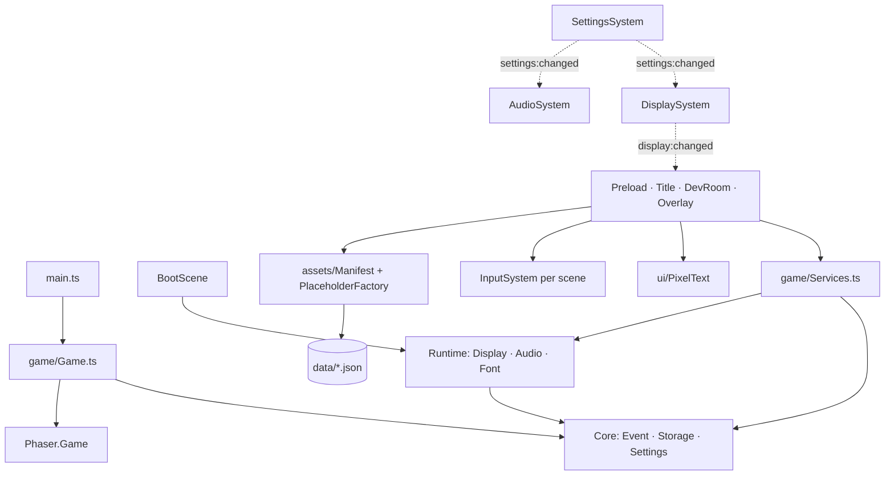

# UNCLAIMED — 기술 아키텍처

> 문서 버전 0.3 · v0.1.0 (PHASE 8, 0장+1장) 기준 · 코드와 어긋나면 코드를 기준으로 이 문서를 고칩니다.

## 1. 기술 스택 (확정)

| 영역 | 선택 | 버전 | 이유 |
|---|---|---|---|
| 언어 | TypeScript (strict, `noUncheckedIndexedAccess`) | 5.9.3 | 데이터 주도 게임에서 타입이 곧 콘텐츠 검증 |
| 엔진 | Phaser 3 | 3.90.0 | 지시된 엔진. 3.x 최종 안정판. (4.x는 API가 크게 다르고 생태계가 아직 3.x 중심) |
| 번들러 | Vite | 7.3.8 | 빠른 HMR, 정적 호스팅 가능한 상대 경로 빌드 (`base: './'`) |
| 테스트 | Vitest (단위) + Playwright (브라우저 스모크) | 4.1.12 | 순수 로직은 Node에서, 렌더링·입력·배율은 실제 Chromium에서 |
| 오디오 | Web Audio API (Phaser의 AudioContext 공유) | — | 합성 효과음·캐릭터 보이스 블립, 버스 단위 볼륨 |
| 저장 | LocalStorage + 버전 봉투(envelope) | — | 손상·구버전·미래버전 데이터를 중단 없이 처리 |
| 폰트 | Galmuri11 / Galmuri11 Bold / Galmuri9 (SIL OFL 1.1) | 2.40.3 | 한글 11,172자 전부 포함한 픽셀 폰트. 배포본은 서브셋(§2.2) |

**추가 도입을 보류한 것과 이유**

- **Howler.js** — Phaser가 이미 Web Audio 언락·디코딩을 처리합니다. 중복 레이어를 피합니다.
- **GSAP** — Phaser Tweens로 충분합니다. 컷신 타임라인이 복잡해지는 PHASE 7에서 재검토합니다.
- **Zustand** — 상태는 `GameState`(PHASE 2) + 타입 이벤트 버스로 관리합니다. React가 없으므로 이점이 작습니다.
- **Tiled** — 도입하지 않았습니다. 맵은 리뷰·diff가 쉬운 자체 ASCII 레이아웃 JSON(§5.1)입니다.
- **GSAP** (재검토 결과) — 시네마 바·와이프·엔딩 연출 모두 Phaser Tweens와 async 스크립트 명령으로 충분했습니다.

## 2. 렌더링 원칙: 480×270 네이티브 픽셀

모든 아트·UI·텍스트는 **480×270 백버퍼**에 그려지고, 그 캔버스를 통째로 확대합니다.

- 1080p에서 정확히 4배, 4K에서 8배. 16px 타일 기준 화면에 30×17타일.
- `pixelArt: true`, `roundPixels: true`, CSS `image-rendering: pixelated`.
- **기기 픽셀 기준 정수 배율** (`src/utils/ScaleUtils.ts`): Windows 125% 배율의 1536×864 CSS 화면은 실제 1920×1080 기기 픽셀이므로, CSS 3배(=기기 3.75배, 픽셀 폭 불균일)가 아니라 기기 4배(=CSS 3.2배)를 선택합니다. 캔버스 위치도 기기 픽셀 격자에 맞춥니다.
- 배율 모드: `auto`(정수 배율이 최대 크기의 85% 이상이면 정수, 아니면 화면 맞춤) / `pixel-perfect` / `fit`. 설정에 저장됩니다.
- 회전·확대로 스프라이트를 변형하지 않습니다(픽셀이 뭉개짐). 흔들림은 위치 이동으로, 크기 변화는 정수 배율로만 표현합니다.
- 그라데이션은 블렌딩 대신 **Bayer 디더링**으로 팔레트 색만 사용합니다 (`src/utils/DitherUtils.ts`).

### 2.1 한글 픽셀 텍스트 파이프라인

캔버스 `fillText`는 안티에일리어싱이 들어가 480×270에서 회색 번짐이 생기고, 확대하면 얼룩이 됩니다. 한글은 완성형만 11,172자라 사전 제작 비트맵 폰트도 비현실적입니다.

`src/systems/FontSystem.ts`의 해법:
1. 웹 폰트(Galmuri)를 **네이티브 크기**(11→12px, 9→10px)에서 글자 단위로 래스터화
2. 알파 임계값 처리 → 1비트 픽셀로 변환
3. 공유 아틀라스(256px에서 시작, 필요 시 2배씩 최대 2048px)에 패킹 → Phaser BitmapFont로 등록
4. **처음 쓰이는 순간 동적으로 추가**. 대사 데이터는 로딩 중 `fonts.preload(text)`로 미리 굽습니다(PHASE 3).
5. 글자는 흰색, 색은 틴트. 큰 글씨는 폰트를 정수배(2x, 3x)로 확대.

모든 게임 내 텍스트는 `PixelText`(`src/ui/PixelText.ts`)를 씁니다. `Phaser.Text`는 사용하지 않습니다.

### 2.2 폰트 서브셋과 글리프 보증

`scripts/subset-fonts.py`(fonttools)가 원본 Galmuri에서 쓰지 않는 블록(한자 약 6,400자 등)을 제거합니다: 1.1 MB → 484 KB.
라틴·문장부호·화살표·도형·기호·가나·호환 자모·**완성형 한글 11,172자 전부**·전각 문자를 남깁니다(이름은 OS 입력기로 들어오므로 KS X 1001 2,350자로는 부족).
스크립트는 남은 글리프 범위를 `src/assets/fonts/coverage.json`에 기록하고, `tests/unit/Fonts.test.ts`가 콘텐츠 전체·UI 문자열·**소스 코드의 모든 비ASCII 문자**를 그 범위와 대조합니다. 폰트에 없는 글자가 들어가면(예: `✓`) 테스트가 실패합니다.

## 3. 계층 구조

```
┌─────────────────────────────────────────────────────────┐
│ scenes/  (Phaser Scene: 흐름과 조립만)                   │
│ ui/      (Phaser GameObject 기반 UI 컴포넌트)            │
│ entities/(Player, NPC, Soul, Bullet …: 화면 위 존재)     │
├─────────────────────────────────────────────────────────┤
│ systems/ (서비스: 규칙과 상태)                           │
│   Phaser 의존: Display, Input, Audio, Font, Bullet       │
│   순수 TS   : Event, Settings, Storage, Locale,          │
│               Story, Inventory, Dialogue 파서, Battle 규칙│
├─────────────────────────────────────────────────────────┤
│ data/    (JSON: 대사, 캐릭터, 적, 아이템, 맵, 에셋 목록)   │
│ utils/   (순수 함수: 수학, 배율, 디더링, 트윈 헬퍼)       │
└─────────────────────────────────────────────────────────┘
```

**의존성 규칙**

1. 위 계층은 아래 계층을 import할 수 있고, 반대는 금지입니다.
2. **시스템끼리는 직접 import하지 않고** `EventSystem`(타입 이벤트 버스)으로 통신합니다. 예외: 생성 시 주입(예: `SettingsSystem`이 `SafeStorage`를 받음).
3. 게임 규칙(전투 판정, 스토리 분기, 인벤토리)은 **Phaser를 import하지 않는 순수 TS**로 작성해 Vitest로 검증합니다. 상수는 Phaser 없는 `src/game/Constants.ts`에 있습니다.
4. 씬은 다른 씬을 import하지 않습니다. 전환은 키(`SCENE_KEYS`)로만 합니다.
5. UI는 게임 상태를 직접 바꾸지 않고 시스템의 메서드를 호출합니다.
6. 텍스트·수치·대사는 `src/data`에 둡니다. 코드에는 키만 있습니다.



## 4. 부팅 순서

1. `main.ts` → `GameApp` 생성: **코어 서비스**(Event, SafeStorage, Settings)는 Phaser보다 먼저 만들어집니다 (설정이 첫 프레임 배율에 필요).
2. `Phaser.Game` 부팅 → `BootScene.create()`
   - `DisplaySystem`(캔버스 필요), `AudioSystem`(AudioContext 필요) 생성
   - 웹 폰트 로딩 대기(타임아웃 8초, 실패 시 폴백 + 경고) → `FontSystem` 생성
   - 서비스 등록 → `OverlayScene` 실행(항상 최상단) → `PreloadScene`
3. `PreloadScene`: 매니페스트의 파일을 실제 진행률 바와 함께 로드 → 파일이 없거나 실패한 에셋은 플레이스홀더 생성(게임은 계속 실행) → 공용 애니메이션 등록 → 타이틀로 페이드.

씬 목록 순서가 곧 렌더 순서입니다. `OverlayScene`은 반드시 마지막입니다.

## 5. 시스템별 역할

### PHASE 1에서 구현됨

| 파일 | 역할 | 의존 |
|---|---|---|
| `game/Constants.ts` | 해상도, 타일 크기, 팔레트, 폰트, 깊이 대역, 씬 키 | 없음 |
| `game/GameConfig.ts` | Phaser 설정 생성 | Constants |
| `game/Game.ts` | 앱 루트, 전역 단축키(F3 디버그, F4/Alt+Enter 전체화면), 정리 | 코어 서비스 |
| `game/Services.ts` | 서비스 레지스트리 (`getServices(game)`) | — |
| `systems/EventSystem.ts` | 타입 안전 이벤트 버스, 리스너 예외 격리 | — |
| `systems/storage/SafeStorage.ts` | 절대 throw하지 않는 localStorage (차단·용량 초과 시 메모리 폴백) | — |
| `systems/storage/VersionedStore.ts` | 버전 봉투 + 체크섬 + 마이그레이션 + 격리(quarantine) | SafeStorage |
| `systems/SettingsSystem.ts` | 볼륨, 텍스트 속도, 배율, 흔들림, 플래시 완화, FPS, 터치 컨트롤 — 필드 단위 검증 | VersionedStore, Event |
| `systems/DisplaySystem.ts` | 배율 계산 적용, 리사이즈/회전/DPR 변경/전체화면 대응 | ScaleUtils, Event |
| `systems/InputSystem.ts` | 키보드·게임패드·터치 → 액션 매핑, 메뉴 자동 반복, 씬별 생성·자동 해제 | Phaser |
| `systems/AudioSystem.ts` | music/sfx/voice 버스, 설정 연동 볼륨, JSON 정의 합성 효과음 | Phaser, Settings |
| `systems/FontSystem.ts` | 런타임 한글 비트맵 폰트 아틀라스 | Phaser |
| `systems/LocaleSystem.ts` | UI 문자열 조회 (`ko` 기본, `en` 폴백) | data/strings |
| `systems/assets/AssetManifest.ts` | 에셋 목록 로드·검증, 상태(placeholder/wip/final) | data/assets |
| `systems/assets/PlaceholderFactory.ts` | 인라인 픽셀아트 래스터화, 명백한 플레이스홀더 생성 | Constants |
| `ui/PixelText.ts` | 선명한 픽셀 텍스트 GameObject | FontSystem |
| `scenes/*` | Boot, Preload, Title(PHASE 1판), DevRoom(개발용), Overlay(디버그) | 위 전부 |

**입력 매핑** (`KeyboardEvent.code` 기준 — 한글 IME가 켜져 있어도, AZERTY 배열이어도 동작)

| 액션 | 키보드 | 게임패드 |
|---|---|---|
| 이동 | 방향키 / WASD | D-pad / 왼쪽 스틱 |
| confirm | Z / Enter / Space | A |
| cancel | X / Shift / Backspace | B |
| menu | C / Ctrl | Y / X |
| pause | Esc | Start |

### PHASE 2–4에서 구현됨

| 파일 | 역할 | 의존 |
|---|---|---|
| `game/GameState.ts` | 저장되는 모든 상태(이름·HP·위치·인벤토리·장비·플래그·관계·조우 기록·통계), 검증, 조건 키 해석기 | 순수 |
| `game/GameSession.ts` | 진행 중인 플레이(상태 + 슬롯 + 인벤토리), 플레이 시간 | SaveSystem |
| `systems/SaveSystem.ts` | 슬롯 3개 × (수동 + 백업 + 자동), 최신/수동 우선 불러오기, 요약 | VersionedStore |
| `systems/InventorySystem.ts` | 사용·장착(제자리 교체)·버리기·정렬, 공격/방어 합산 | 순수 |
| `systems/script/Condition.ts` | 조건식 파서·평가기 (캐시) | 순수 |
| `systems/text/RichText.ts`, `TextWrap.ts` | 인라인 마크업 → 글자별 색/효과/이벤트, 줄바꿈 | 순수 |
| `systems/DialogueSystem.ts` | 스크립트 VM (호스트 인터페이스로 UI·명령 위임) | 순수 |
| `systems/BattleSystem.ts` | 전투 규칙 모델 | 순수 |
| `systems/BulletSystem.ts` | 탄 풀 + 에미터 9종 + 충돌 | Phaser |
| `systems/content/ContentDB.ts` | `src/data` 전체 로드 + 구조·교차 참조 검증 | 순수 |
| `systems/assets/PixelArt.ts` | 픽셀아트 문서 해석(파생 프레임: from/mirror/parts/palette/shift) | 순수 |
| `systems/audio/MusicPlayer.ts` | 룩어헤드 스텝 시퀀서, 크로스페이드 | Web Audio |
| `systems/VirtualControls.ts` | 터치 컨트롤 공유 상태 | — |
| `scenes/MenuScene.ts` | 타이틀 + 메인 메뉴 + 슬롯/이름/설정/크레딧 패널 | UI 키트 |
| `scenes/WorldScene.ts` | 맵 구성, 탐험, 상호작용, 스크립트 호스트(DialogueHost) | 위 전부 |
| `scenes/BattleScene.ts` | 전투 턴 루프(async), 회피 | BattleModel, BulletSystem |
| `scenes/GameOverScene.ts` | 게임 오버, 마지막 기록에서 재시작 | SaveSystem |
| `entities/Player.ts`, `NPC.ts`, `Soul.ts`, `Enemy.ts` | 화면 위 존재와 그 움직임 | Phaser |
| `ui/Panel.ts`, `ListMenu.ts`, `UIStack.ts` | 창 프레임, 범용 선택 목록(키보드·탭), 포커스 스택 | Phaser |
| `ui/MenuPanels.ts`, `NameEntryPanel.ts`, `PauseMenu.ts` | 확인·메시지·설정·슬롯·크레딧·이름·일시정지·저장 패널 | UI 키트 |
| `ui/DialogueUI.ts`, `BattleUI.ts`, `TouchControls.ts` | 대화창, 전투 위젯, 터치 컨트롤 | UI 키트 |

### PHASE 5–8에서 구현됨

| 파일 | 역할 | 의존 |
|---|---|---|
| `systems/StorySystem.ts` | 루트 판정(return/keep/clear), 공허해진 세계 판정, 퀘스트 상태 | 순수 |
| `systems/MetaSystem.ts` | 세이브와 분리된 영구 기록: 본 엔딩, 마지막 치움 시각, "되돌리기" 감지 횟수, 시작 횟수 | VersionedStore |
| `systems/Particles.ts` | 씬당 Graphics 1개, 풀 256개, 정수 좌표 픽셀 파티클 | Phaser |
| `entities/Follower.ts` | 동료(발자취 추적, 일정 거리 유지) | Phaser |
| `entities/Soul.ts` (확장) | 영혼 모드 `free` / `tether`(끈 묶임 진자) | Phaser |
| `entities/Enemy.ts` (확장) | 페이즈별 애니메이션, 진정 프레임 | Phaser |
| `systems/BattleSystem.ts` (확장) | 페이즈 진입 `advancePhases`, `soulMode`, ACT의 플래그 변경·전투 종료, `hp%` | 순수 |
| `scenes/EndingScene.ts` | 루트별 엔딩(조건부 페이지) → 크레딧(Z로 빠르게) → 마지막 문장 → 타이틀 | StorySystem, MetaSystem |
| `ui/ShopPanel.ts` | 상점(초상화, 인사·감사·잔액 부족 문구, 단추 결제) | UI 키트 |
| `game/ErrorOverlay.ts` | 런타임 오류 알림: 같은 출처의 잡히지 않은 오류/거부된 Promise → 게임 루프 정지 + 새로고침/계속하기, 1회만 | DOM |

> 별도의 `entities/Boss.ts`는 만들지 않았습니다. 보스는 일반 적 데이터에 `phases`(조건 → 스프라이트·영혼 모드·문구)와 전용 곡을 더한 것이고, 연출은 맵 스크립트 명령(`cinema`, `music`, `npc.move`)으로 처리합니다. 데이터로 충분해 클래스를 늘리지 않았습니다.

## 5.1 콘텐츠 데이터 형식

모든 콘텐츠는 `src/data` 아래 JSON이며 `tests/unit/Content.test.ts`가 출하 전 전부 검증합니다.

| 위치 | 형식 요약 |
|---|---|
| `data/maps/<id>.json` | `layout`(ASCII 행) + `legend`(문자 → 타일/장식/solid/secret/over), `spawns`, `npcs`, `objects`, `exits`, `triggers`(once), `savePoints`, `encounters`, `music`, `ambience`, `onEnter` |
| `data/dialogues/*.json` | `{ "스크립트ID": [노드…] }`. 노드: `say`(+`who`,`face`,`speed`) · `choice` · `if/then/else` · `goto` · `call` · `set` · `do`(명령) |
| `data/enemies/<id>.json` | 능력치, `vars`, `acts`(조건·필요조건·변수 변경·조건부 문구), `spareWhen`, `flavor`, `speech`, `patterns`(조건부) + `patternDefs`(에미터 목록) |
| `data/items/items.json` | `consumable`/`weapon`/`armor`/`key`, 회복·공격·방어, 사용 문구 |
| `data/characters/*.json` | 이름, 이름표 색, 초상화·필드 스프라이트 에셋, 보이스(파형·음높이·변화폭·간격), 작가용 노트 |
| `data/audio/songs/<id>.json` | BPM, 스텝/박, 채널(파형·볼륨·게이트·패턴: 음이름 / `.` 쉼 / `-` 지속 / 드럼 `k s x o`) |
| `data/art/*.json` | 픽셀아트 문서(팔레트 인덱스 문자열 행, 파생 프레임, 애니메이션) |
| `data/story/*.json` | 시작 위치·아이템, 이름 반응, 크레딧, `quests.json`(activeIf/doneIf 조건식), `endings.json`(루트별 제목·곡·조건부 페이지·마지막 문장) |
| `data/shops/<id>.json` | 주인 캐릭터, 품목·가격, 인사·감사·잔액 부족 문구(무작위 선택) |

조건 키: `flag:<id>`, `item:<id>`, `rel:<id>`, `met:/spared:/cleared:<enemy>`, `stat:<name>`, `hp`, `maxHp`, `buttons`, `map`, `meta:undoNotices`, 전투 중 `var:<변수>`, `acted:<act>`, `hp%`(= `var:hp%`), `turn`.

스크립트 명령(전체): `sfx`, `music`, `shake`, `flash`, `wait`, `face`, `item.add/remove`, `buttons`, `heal`, `relation`, `battle`, `save`, `map`, `npc.hide/show/face/move`, `player.face`, `end`, `shop`, `cinema`, `follower`, `ending`.

## 6. 데이터 설계 원칙

- **JSON = 콘텐츠, TS = 규칙.** 대사·적·아이템·맵 이벤트는 JSON. 로딩 시 검증 함수가 구조를 확인하고, 잘못된 항목은 명확한 오류를 남기고 건너뜁니다(게임은 계속 실행).
- 모든 데이터 파일은 Vitest에서 "출하되는 데이터가 유효한가" 테스트를 갖습니다 (예: `tests/unit/AssetManifest.test.ts`, 한/영 문자열 키 일치 검사).
- 저장 데이터는 `{ format, version, savedAt, checksum, data }` 봉투로 감쌉니다. 읽기 결과는 `ok | empty | corrupt | future-version` 중 하나이며 예외를 던지지 않습니다. 손상 데이터는 지우지 않고 `*.corrupt` 키로 격리합니다.

## 7. 성능 예산

| 항목 | 목표 | 현재 (v0.1.0) |
|---|---|---|
| 프레임 | 60 FPS 고정 | 60 FPS (헤드리스 Chromium, 소프트웨어 WebGL) |
| 초기 JS | Phaser 제외 < 150 KB gzip | 102.6 KB gzip — 아트 24종·맵·대사·곡 데이터 포함 (+ Phaser 332 KB gzip, 별도 청크) |
| 폰트 | < 1.2 MB | 484 KB (서브셋, §2.2) |
| 탄막 | 동시 500발에서 60 FPS | `npm run bench`: 2,000발에서 60 FPS, `update` 0.09 ms/프레임 (소프트웨어 렌더링 하한값). 풀 재사용 확인 |
| 메모리 | 씬 왕복 시 증가 없음 | 스모크 테스트가 왕복 후 리스너·객체 수 불변, 벤치마크가 정리 후 남은 탄 0을 검사 |

## 8. 테스트 전략

| 명령 | 내용 |
|---|---|
| `npm run typecheck` | 앱(`tsconfig.json`)과 빌드 설정(`tsconfig.node.json`) 타입 검사 |
| `npm test` | Vitest 단위 테스트 82개 (배율, 저장·슬롯, 설정, 이벤트, 조건식, 대화 VM, 전투 규칙·페이즈, 인벤토리, 리치 텍스트·조사, 픽셀아트, 루트·메타, 출하 콘텐츠 교차 검증, 폰트 글리프 커버리지) |
| `npm run build` | 타입 검사 + 프로덕션 빌드 |
| `npm run smoke` | Chromium 7개 구역: 레이아웃 5종, 데스크톱 0장 여정, 휴대폰 터치 여정, 1장 두 루트 전체 플레이, 저장소 손상, 기기 프로필 6종, 런타임 오류 알림 (`--only`로 일부 실행, ROADMAP 참고) |
| `npm run bench` | 탄막 부하(동시 80~2,000발): FPS·프레임 시간·`update` 비용·풀 누수 |
| `npm run assets:report` | 에셋 상태 목록. `-- --strict`는 플레이스홀더가 남아 있으면 실패 (출시 게이트) |

새 기능은 이 항목들을 모두 통과해야 "완료"입니다.
